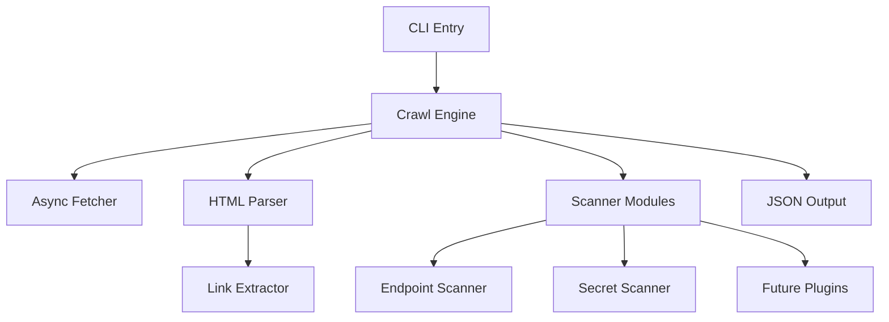

# Pathscope

**Repository:** https://github.com/seraphimhub/Pathscope

## Overview
Pathscope is a **high-performance asynchronous web discovery framework** built for **authorized internal security auditing**, **route intelligence**, and **surface mapping**.

Designed with a modular architecture, Pathscope combines:
- deep recursive crawling
- endpoint discovery
- secret pattern scanning
- JavaScript-aware endpoint extraction
- structured JSON output

It is optimized for modern engineering and security teams working with complex internal web estates.

---

## Architecture


---

## Core Capabilities

*  Bounded-concurrency asynchronous crawling (fixed worker pool)
*  Deep recursive internal route traversal
*  Endpoint extraction from HTML and JavaScript
*  Secret pattern discovery without exposing secret values
*  Strict host-scope enforcement, including every redirect hop
*  Optional private/loopback/metadata address guard enforced at DNS resolution
*  Redirect chain following with loop detection and hop limits
*  Per-URL error isolation (one failure never aborts the scan)
*  Response size caps and non-text content rejection
*  Structured, de-duplicated JSON findings

---

## Terminal Preview

```bash id="83x5dm"
$ python3 cli.py --target https://example.com --depth 3 --workers 8

███████╗███████╗██████╗  █████╗ ██████╗ ██╗  ██╗██╗███╗   ███╗
██╔════╝██╔════╝██╔══██╗██╔══██╗██╔══██╗██║  ██║██║████╗ ████║
███████╗█████╗  ██████╔╝███████║██████╔╝███████║██║██╔████╔██║
╚════██║██╔══╝  ██╔══██╗██╔══██║██╔═══╝ ██╔══██║██║██║╚██╔╝██║
███████║███████╗██║  ██║██║  ██║██║     ██║  ██║██║██║ ╚═╝ ██║
╚══════╝╚══════╝╚═╝  ╚═╝╚═╝  ╚═╝╚═╝     ╚═╝  ╚═╝╚═╝╚═╝     ╚═╝

[0] https://example.com
[1] https://example.com/search
[1] https://example.com/about
[2] https://example.com/preferences
```

---

## Installation

Requirements: Python 3.11 or newer (CI covers 3.11, 3.12 and 3.13).

Clone the repository:

```bash id="0z9wzj"
git clone https://github.com/seraphimhub/Pathscope.git
cd Pathscope
```

Create virtual environment:

```bash id="zt4u0e"
python3 -m venv .venv
source .venv/bin/activate
```

Install dependencies:

```bash id="o8e5j1"
pip install -r requirements.txt
```

Playwright is pinned in `requirements.txt` for the planned SPA renderer; the
current crawler is HTTP-only and never needs a browser. Installing Chromium is
only required when that renderer lands:

```bash id="nztc95"
playwright install chromium
```

---

## Quick Start

### Via environment

Every scan must state its authorization (see below); use `--lab-mode` only for
a host you own.

```bash id="uz4w5e"
TARGET_URL=https://example.com python3 cli.py --authorized-by "TICKET-42" --depth 2
```

### CLI mode

```bash id="d9u3v0"
python3 cli.py --target https://example.com --authorized-by "TICKET-42" --depth 3 --workers 8
python3 cli.py --target http://127.0.0.1:8080 --lab-mode --depth 2
```

### Common options

```text
--target URL              target to crawl (or the TARGET_URL env var)
--depth N                 maximum crawl depth (default 2)
--workers N               concurrent request budget (default 8)
--max-pages N             hard cap on visited pages (default 1000)
--timeout SECONDS         per-request timeout (default 20)
--max-redirects N         redirect hops followed per request (default 5)
--output-dir PATH         where findings.json is written (default "output",
                          or PATHSCOPE_OUTPUT_DIR)
--block-private           refuse loopback/private/link-local/metadata targets
--allow-private           permit private targets (default)
--allow-scheme-downgrade  follow https -> http redirects (off by default)
--secrets/--no-secrets    toggle secret pattern scanning (default on)
--endpoints/--no-endpoints
                          toggle endpoint discovery (default on)
--js/--no-js              toggle JavaScript analysis (default on)
--headers JSON|k:v        additional request headers
--cookie JSON|k:v         cookies to send
--api VALUE               API key or JSON token for auth
--auth VALUE              auth profile or token
--authorized-by TEXT      who authorized the scan (required unless lab mode)
--scope-file PATH         YAML file: owner, reference, allowed_hosts, validity
--lab-mode                no external authorization; local host you own only
--rps N                   maximum request starts per second (0 = unlimited)
--delay SECONDS           minimum gap between request starts
--jitter SECONDS          random extra delay per request
--max-retries N           retries for 429/503, honoring Retry-After (default 2)
--max-error-rate N        circuit-breaker threshold after 20 attempts (default 0.5)
--user-agent TEXT         User-Agent sent with every request
--scan-id TEXT            optional X-Pathscope-Scan-Id correlation header
--robots [off|report|respect]
                          robots.txt policy (default off)
--config PATH             YAML config file
--quiet                   suppress the summary
--json                    emit a machine-readable summary to stdout
```

Exit codes: `0` for a completed scan (and for a clean Ctrl-C), `2` for an
invalid target, a rejected configuration or authorization, or a policy refusal
such as `--block-private` on a private address.

---

## Output

Findings are exported to:

```text id="ywus6g"
output/findings.json
```

Example:

```json id="x07m2m"
[
  {
    "type": "endpoint",
    "url": "https://example.com/app.js",
    "endpoint": "/api/v1/users",
    "category": "path",
    "evidence": "/api/v1/users",
    "line": 12
  },
  {
    "type": "secret_pattern",
    "url": "https://example.com/config.js",
    "pattern": "token",
    "category": "token",
    "evidence": "var token = \"********\";",
    "line": 4,
    "count": 1
  }
]
```

Every finding carries `evidence`, `category`, and `line` so a reviewer can
check it without re-fetching the page. Findings are de-duplicated and never
contain the matched secret value: quoted literals and long unquoted values in
`evidence` are masked with `*`. A match is a pattern occurrence only — Pathscope
does not verify that a credential is live and never uses one.

Endpoints stay globally de-duplicated and add a `pages` list naming every page
that exposed one. Secret patterns are de-duplicated per page, pattern, and line,
so the same pattern on the same line of two pages is two findings.

`<output_dir>/scan.json` records the scan metadata (target, scope, timestamps,
effective configuration, authorization, identity, rate-limit and robots
settings, counters, status counts, circuit-breaker state) and the full error
list, so a failed URL is auditable after the run instead of only living in the
terminal. `<output_dir>/audit.jsonl` is the append-only governance trail.
Output files are written atomically and are readable by the owner only
(`0600`). `--json` prints a separate machine-readable scan summary to stdout.

---

## Safe operation and governance

### Authorization gate

A scan refuses to start without an explicit authorization record:

```bash
python3 cli.py --target https://app.example.com --authorized-by "AppSec / TICKET-42"
```

A scope file is stricter and is validated before any request:

```yaml
# scope.yaml
owner: Acme AppSec
reference: ENG-1234
allowed_hosts:
  - app.example.com
  - "*.internal.example.com"
not_before: 2026-01-01T00:00:00Z
not_after: 2026-02-01T00:00:00Z
```

`python3 cli.py --target https://app.example.com --scope-file scope.yaml`
refuses unknown keys, a wildcard `*`, missing owner/reference, an expired or
not-yet-valid window, and a target host that the file does not cover.
`--lab-mode` is the only way to run without authorization; it is meant for a
host you own and is recorded as such. The decision appears in `scan.json`
(`authorization`) and in the audit log.

### Rate control, retries and circuit breaker

`--rps`, `--delay` and `--jitter` share one schedule across all workers, so
concurrency cannot multiply the request rate. `429` and `503` responses are
retried up to `--max-retries` times, honoring `Retry-After` (delta seconds or
HTTP date) and otherwise backing off exponentially, capped at 30 seconds. Once
at least 20 attempts have been made, an error rate above `--max-error-rate`
(transport errors, 5xx, and retried throttling) opens a circuit breaker: queued
URLs are dropped, the reason is logged, audited, and written to
`scan.json.circuit_breaker`.

### robots.txt

`--robots off` (default) ignores the file, `report` records every disallowed URL
in the audit log but still crawls, and `respect` skips disallowed paths and
counts them under `robots.blocked`. Only the `*` group is applied; the crawler
never fetches `robots.txt` in `off` mode.

### Identification

The default User-Agent is `Pathscope/<version> (+repository URL)`, configurable
with `--user-agent`. `--scan-id` adds `X-Pathscope-Scan-Id` so a defender can
correlate traffic, and is also recorded in metadata and the audit log.

### Audit log and redaction

`<output_dir>/audit.jsonl` is append-only JSON lines (`0600`) recording scan
start/stop, authorization, a SHA-256 hash of the effective configuration, every
refused request with its stage and reason, retries, and circuit-breaker events.

URL userinfo is removed from findings, errors, logs, `scan.json`, and the audit
log. Header, cookie, bearer/basic, and token assignment values are replaced with
`[REDACTED]` in free-form error text. This is covered by unit tests with
crafted exception strings, not only by code review.

---

## Scope and SSRF protection

One policy module (`core/security.py`) is used by the CLI, the engine, the
fetcher, and every URL source (links, JavaScript, redirects):

* hosts are canonicalized (IDNA, trailing dot, default port, IPv6 brackets)
  before comparison, so `https://example.com./` cannot slip past scope checks;
* the scope is an exact host match (with the default port normalized), so
  unrelated hosts, other ports, and subdomains such as `admin.example.com` are
  dropped even when reachable — the policy supports an explicit subdomain
  opt-in, but the crawler does not enable it;
* redirect `Location` headers are re-checked hop by hop and never trusted
  because the original host passed; the canonical `host:port` pair must stay
  identical, and an `https` -> `http` hop is refused by default because the
  session's auth/cookie headers would be sent in cleartext
  (`--allow-scheme-downgrade` opts in explicitly);
* with `--block-private`, address checks run **inside the resolver handed to
  the HTTP transport**. Every address in the DNS answer (IPv4, IPv6,
  IPv4-mapped, loopback, private, link-local, unspecified, multicast) is
  rejected if any one is non-public, and the connector dials the exact
  addresses that were validated. A second lookup between check and connect
  (DNS rebinding) therefore cannot swap in a private address.

Private targets remain allowed by default (local lab testing); `--block-private`
is opt-in. Scope rules apply regardless of that setting.

---

## Configuration

`--config pathscope.yaml` accepts a mapping of any CLI option:

```yaml
target: https://example.com
depth: 3
workers: 8
timeout: 10
block_private: true
```

Precedence is explicit: command-line flags (when actually typed) override the
config file, which overrides defaults. Config files are validated before a scan
starts — unknown keys are kept for forward compatibility, but wrong types,
out-of-range numbers, unreadable YAML, and a non-mapping root are rejected with
exit code 2 instead of silently falling back to defaults. For security-relevant
keys such as `block_private`, the value you actually pass on the command line
wins over the file, and the file wins over the built-in default; nothing is
applied silently.

---

## Benchmarking

The crawler ships with a reproducible local harness:

```bash
python -m benchmarks.bench_crawler --scenario low-latency --runs 3
python -m benchmarks.bench_crawler --scenario all --levels 1,2,4,8,16 --runs 5
```

Scenarios cover low and high latency, a slow server, dropped connections,
large responses, and pages full of duplicate links. Each level is run several
times; the report separates graph size, responses, attempts, HTTP requests,
successful fetches, transport errors, elapsed time, throughput, and the
maximum concurrency actually observed by the server, and prints best/median/min
throughput plus the spread. These are single-machine measurements — compare
levels within one run rather than quoting absolute numbers.

---

## Testing

```bash
python -m pytest tests/ --strict-markers -q
```

Beyond unit and integration tests, the suite includes:

* `tests/security/test_ssrf_and_scope_bypass.py` — address classification,
  canonicalization tricks, and connector-level proof that a private DNS answer
  is never dialed;
* `tests/unit/test_discovery_accuracy.py` — precision/recall against a labelled
  fixture (`tests/fixtures/discovery/`), including commented-out examples that
  must stay unmatched and relative strings that are expected negatives;
* `tests/unit/test_config_validation.py` — malformed, missing, mistyped, and
  out-of-range configuration plus CLI-over-config precedence;
* `tests/unit/test_benchmark_harness.py` — sanity checks on benchmark metrics;
* `tests/unit/test_redaction.py` — URL userinfo, header/cookie/token values, and
  crafted exception strings through the redaction layer;
* `tests/unit/test_authorization.py` and `tests/integration/test_cli_governance.py`
  — the authorization gate, scope-file validation/windows, and recorded metadata;
* `tests/unit/test_throttle.py`, `tests/unit/test_robots.py`, and
  `tests/crawler/test_engine_safe_operations.py` — pacing, Retry-After, circuit
  breaking, robots policy, audit log integrity, identity headers, and redaction
  of persisted output.

---

## Project Structure

```text
Pathscope/
├── cli.py              # Click entry point, config merging, summaries
├── core/               # config, scope/address policy, DNS resolver, models
├── crawler/            # engine, fetcher, HTML/JS parser
├── scanners/           # endpoint and secret-pattern scanners
├── benchmarks/         # reproducible crawler benchmark harness
├── tests/              # unit, integration, security tests and fixtures
├── output/             # default findings.json destination
├── requirements.txt
└── .github/workflows/ci.yml
```

---

## CI / Quality

Workflow:

```text id="rq9tv5"
.github/workflows/ci.yml
```

Jobs:

* `quality` on Python 3.11, 3.12 and 3.13 — import validation, `ruff check .`,
  `ruff format --check .`, `mypy` on `core`, `crawler`, `scanners`, `bandit`
  static scan, the full `pytest` suite, and a coverage report
* `smoke` — boots the CLI and verifies the public surface still imports and runs
* a guard that rejects known secret patterns (AWS key shape, fake test tokens)
  in tracked files

Local equivalent:

```bash
ruff check . && ruff format --check .
python -m mypy core crawler scanners
bandit -r core crawler scanners -iii
python -m pytest tests/ --strict-markers -q
python -m pytest tests/ --cov=core --cov=crawler --cov=scanners --cov-report=term-missing
python -m benchmarks.bench_crawler --scenario low-latency --runs 3
```

---

## Security & Responsible Use

Pathscope must only be used for:

* systems you own
* internal engineering audits
* explicitly authorized environments
* approved security assessments

Always maintain:

* safe concurrency
* documented authorization
* operational awareness
* production-safe rate controls

---

## Roadmap

Planned work, not implemented yet:

*  versioned report schema with stable finding IDs and scan diffing
*  SARIF 2.1.0, CSV and self-contained HTML exporters
*  plugin scanner API with per-plugin isolation
*  sitemap.xml / robots.txt ingestion and source-map analysis
*  playbook-driven SPA rendering with the same scope enforcement
*  distributed queue behind the existing in-memory interface

---

## License

Licensed under **GNU Affero General Public License v3.0 (AGPLv3)**.

---

## Trademark Notice

The **Pathscope** name, logo, and branding assets are reserved.

---

## Author

Built and maintained by **[seraphimhub](https://github.com/seraphimhub)**.
